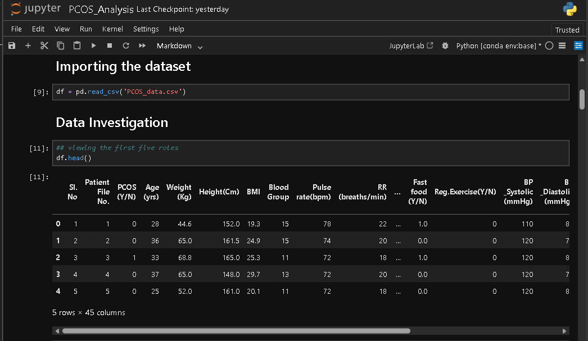
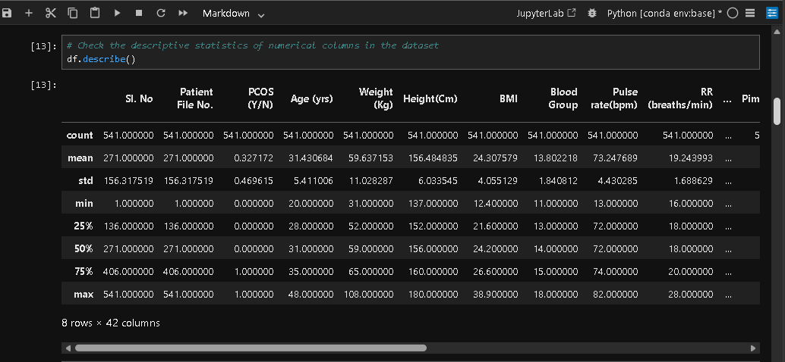
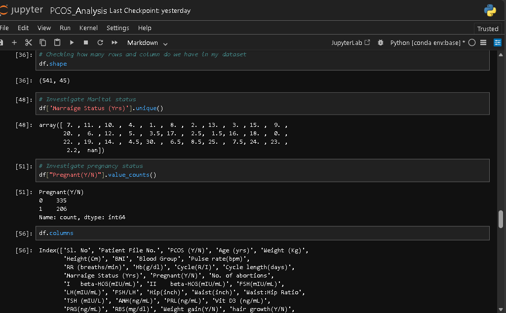
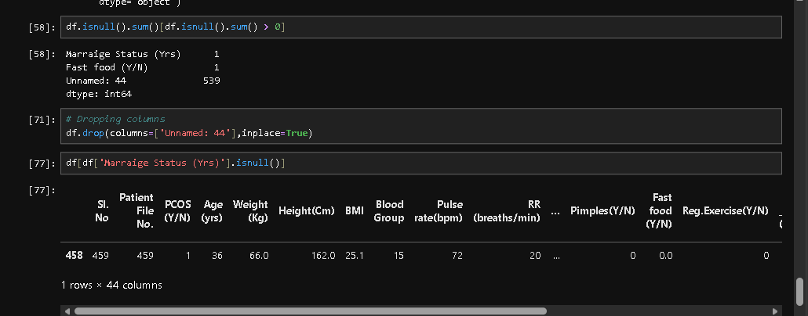
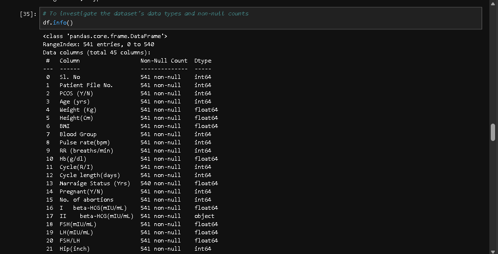

# PCOS-Data-Analytics-
Exploratory data analysis and interactive dashboard development using Python, Pandas, NumPy, and Power BI.

#  PCOS Data Analysis Project

### Turning Patient Data into Meaningful Insights

##  Project Overview

Polycystic Ovary Syndrome (PCOS) is a hormonal condition that affects many women of reproductive age. Understanding patient data can help reveal patterns and relationships that may support further research and informed healthcare discussions.

This project explores a PCOS dataset using Python and Power BI, focusing on data cleaning, exploratory data analysis, and interactive visualization.

The goal is to transform raw data into a cleaner, more understandable format and present findings through visual reports.

##  Project Objectives

- Inspect and understand the structure of the dataset.
- Identify missing values and unnecessary columns.
- Clean and prepare the dataset for analysis.
- Explore relevant variables and potential patterns.
- Build an interactive Power BI dashboard.
- Communicate findings through clear visualizations.

##  Tools and Technologies

- **Python** — data analysis and cleaning
- **Pandas** — data manipulation and preparation
- **NumPy** — numerical operations
- **Matplotlib & Seaborn** — data visualization
- **Jupyter Notebook** — analysis and documentation
- **Power BI** — interactive dashboard development
- **GitHub** — project documentation and version control

##  Project Structure

```text
PCOS-Data-Analysis/
│
├── PCOS_Analysis.ipynb
├── PCOS_Cleaned.csv
├── README.md
│
└── screenshots/
    └── dashboard.png
```

*Note: The screenshots folder and dashboard image should be added after saving your Power BI dashboard screenshot.*

##  Project Workflow

### 1. Data Inspection

I began by examining the dataset's structure, column names, data types, unique values, and missing values to understand its quality before making changes.

### 2. Data Cleaning

The cleaning process included:

- Identifying missing values.
- Removing unnecessary columns, including the serial number, patient file number, and an unnamed column.
- Handling missing values in selected fields.
- Preparing the dataset for further analysis.

### 3. Exploratory Data Analysis

The next stage focuses on understanding the distribution of variables and exploring patterns within the dataset using Python.

### 4. Power BI Visualization

The cleaned dataset was imported into Power BI to develop an interactive dashboard with summary cards, charts, and slicers.

The dashboard is intended to make selected dataset characteristics easier to explore and interpret.

##  Key Deliverables

- A Jupyter Notebook documenting the Python workflow.
- A cleaned dataset prepared for analysis.
- An interactive Power BI dashboard.
- Visual summaries to communicate findings.

##  Skills Demonstrated

- Data quality assessment
- Missing-value inspection and handling
- Data cleaning with Pandas
- Exploratory data analysis
- Data visualization
- Power BI dashboard development
- Analytical thinking and documentation

##  Disclaimer

This project is for educational and portfolio purposes only. It is not intended to provide medical advice, diagnose PCOS, predict individual health outcomes, or replace professional medical evaluation.

The analysis describes patterns in the available dataset and does not establish causation.

##  Future Improvements

- Conduct deeper exploratory data analysis.
- Investigate relationships between relevant variables.
- Improve dashboard interactivity and visual design.
- Document verified findings with appropriate charts.
- Add further data-quality checks and analysis where appropriate.

##  About the Author

I am developing my skills in data analytics by working on practical projects that combine data preparation, analysis, and visualization.

This project is part of my learning journey toward becoming a data analyst, using real-world-style datasets to strengthen my technical skills and communicate insights effectively.

**Tools:** Python | Pandas | NumPy | Power BI | Jupyter Notebook
## Project Screenshots

### 1. Dataset Preview


### 2. Data Inspection


### 3. Data Investigation


### 4. Data Cleaning


### 5. Data Information

